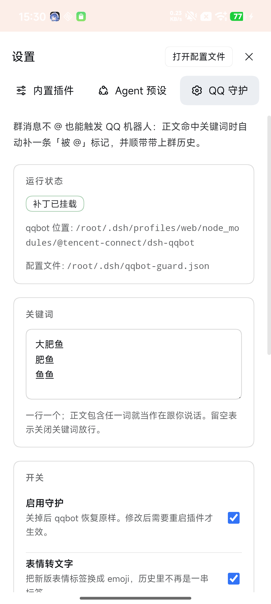

# qqbot-guard

[](https://dsh-plugin.org/plugins/anwesc/dsh-qqbot-guard)

**qqbot 增强层**（伴侣插件）。qqbot 主体仍由用户从插件市场安装（`@tencent-connect/dsh-qqbot`），
本插件只做进程内补丁，不修改 qqbot / SDK 的任何磁盘文件。

装上之后，群里发 **大肥鱼 / 肥鱼 / 鱼鱼**（可改）就能叫醒机器人，不用 @；叫醒后还能**接着聊**：
相关话题里没 @ 的消息也会回，直到 10 分钟没有相关话题才休眠；连着发的几条会合并判定、但逐条回复；
极端刷屏时默认只回判定挑中的相关消息，其余静默；回复要带引用框可以打开 `followUpQuoteReply`（默认关）。
以上都是 1.2.0 起。群历史会带上图片、语音、
文件的摘要。关键词和所有开关都在 DSH 的 **设置 → QQ 守护** 里改，保存即生效（1.1.0 起）。

本仓库是 `dsh-qqbot-guard` 的**唯一真源**（源码、测试、发布都在这里）。
两种来源，包名相同：从插件市场 / npm 单独安装（`dsh-qqbot-guard`），
或随 [dsh-android](https://github.com/anwesc/dsh-android) APK 内置（构建时从 npm 拉同一版本）。

## 它补什么

| 编号 | 现象 | 本插件的处理 |
| --- | --- | --- |
| 1 | 群聊必须 @ 才回，关键词（如 `YONGJIE`）被 `mentionGate` 拦下 | 正文命中关键词时给 `msg.mentions` 补 `{is_you:true}`，`mentionGate` / `slashCommand` 都判成被提及 |
| 2 | 关键词触发时看不到上下文（`inbound.js:209` 只在 `wasMentioned` 时拼历史） | 同上：`wasMentioned` 变 true → `buildAgentBody` 自动带上 `[Chat history]` |
| 3 | 群历史里只剩文字，图片/语音/文件的条目是空行（`history-buffer.js:90-96` 只存 `content`） | 在链头**预下载**附件（`downloadMediaAttachments`），再包装 history store 的 `list`，给条目补 `[图片「a.png」@/…/media/a_…png、语音]` |
| 4 | 表情是占位符 `<faceType=6,faceId="0",ext="eyJ0ZXh0IjoiIn0=">`，上游只读 `ext.text`（是空的） | 解码 `ext.text` 有名字就用名字（如 `捂脸`）；为空则统一给 `[表情]`，**不按 `faceId` 猜**（见下方第 5 条风险） |
| 5 | 群里没触发关键词的消息，附件根本不会下载（`attachmentProcessor` 是链上第 13 层，在 `mentionGate` 后面） | guard 自己在链头调 qqbot 的下载器，历史条目因此能带路径 |
| 6 | 不想动 qqbot 的 `dist` 文件（升级即失效） | 全部走进程内原型补丁，升级 qqbot 不影响本插件文件 |
| 7 | 叫醒一次后，群里不 @ 就再也不接话（跑题了也不敢跟） | 续聊窗口：唤醒后每条消息先判一次「还是同一个话题吗」，是就放行，不是就交给 `mentionGate` 拦停（群里零输出）；连着发的几条合并判定，但回复仍逐条；静默超时自动休眠 |
| 8 | 极端刷屏时逐条判定会排队、回复全是过期的 | 刷屏保护：10 秒内超过 15 条就进入冷却，冷却期默认**只回判定挑中的相关消息**（`select`），其余静默；@ 和关键词照常 |

> 用之前先确认两项前提：QQ 群内该机器人设为「获取群内全部消息」，且 DSH 的 qqbot 插件开着
> 「群聊仅回复 @ 机器人的消息」。缺任一条关键词都不生效，详见[使用前提](#使用前提两条缺一不可)。

**为什么改成伪造 mentions 而不是往日文里塞 `<@appId>`**：`historyBuffer` 是第 4 层、在门控（第 5 层）
之前记录 `ctx.message.content`，往里插标记等于把 `<@102000000>` 写进群历史，再被 `buildAgentBody`
原样拼进 prompt。伪造 `mentions[].is_you` 能达到同样效果且不碰正文；真实 @ 的标记同理，会被搬进
mentions 后从正文摘掉。

## 为什么和加载顺序无关

`@tencent-connect/qqbot-nodejs` 的 `handleInboundMessage` 在**每次收到消息时**才拼链
（`dist/QQBot.js:387` `const chain = [...this.middlewares, downstream]`），而 `middlewares` 是公开数组
（`dist/QQBot.js:80`）。所以本插件不用抢 `bot.use` 的时机，而是在首条入站消息时
`this.middlewares.unshift(guard)` —— 即使 qqbot 插件先启动、链已经建好，补丁照样生效。

## 安装

两种来源写的是同一个目录 `node_modules/dsh-qqbot-guard`，装其中一个即可：

| 来源 | 怎么装 | 谁负责升级 |
| --- | --- | --- |
| 插件市场 / npm | 市场里搜 `dsh-qqbot-guard`，或 `dsh plugin --profile web add dsh-qqbot-guard` | 你自己（市场安装的版本优先） |
| dsh-android 内置 | 随 APK 的 `plugin-seed` 自动复制进 profile | App 发新版时顺带升级 |

`PluginSeed` 每次开机比较「内置版本」与「profile 已装版本」（semver）：已装版本有效且不比内置旧就
**保留不覆盖**；只有缺 `index.js`、没有 `package.json`、版本号非法、或内置版本更新时才用资产覆盖。
所以市场装的新版能活过重启，APK 带更新的内置版时也能自动升级。

反过来，从市场卸载不会让它消失：下次启动内置副本会补回（这是「内置插件」的预期行为）。
不想让它工作就设 `enabled: false`，而不是卸载。

1. 先装好 qqbot（`@tencent-connect/dsh-qqbot`），本插件靠它才能拿到 bot 实例；
2. 装本插件：市场安装，或 `dsh plugin --profile web add dsh-qqbot-guard`；
3. 本包自带 `dsh.bundle.patch`（`cordis.patch.yml`，用 `- insert:` 插入 `qqbot-guard` 行），
   被列入 `dsh.profile.bundles` 后会自动生效——**不要**在 profile 的 `cordis.patch.yml` 里再写一条同 id 的新行；
4. 需要改参数时，三选一（最终都落到同一个 `$DSH_HOME/qqbot-guard.json`）：
   - **设置页（推荐，手机端也能用）**：DSH 里打开「设置 → QQ 守护」，改完点保存，**立即生效、不用重启**；
   - **JSON 后门**：编辑 `$DSH_HOME/qqbot-guard.json`
     （App 里是 `/root/.dsh/qqbot-guard.json`，首次启动由 `PluginSeed` 生成）；
   - **profile patch 覆盖**（能写 YAML 时）：

```yaml
- id: qqbot-guard
  name: 'dsh-qqbot-guard'
  config:
    triggers:
      - '大肥鱼'
      - '小鱼'
      - '鱼鱼'
    qqbotPackage: 'C:/Users/<you>/.dsh/profiles/<profile>/node_modules/@tencent-connect/dsh-qqbot'
    verbose: true
```

5. **重启 App**（bundles 变更不走热重载）。

> 关键机制（`@deepseek-ai/dsh-app-boot` 的 `applyEntryPatches`）：普通 patch 只能改**已存在**的 id，
> 找不到就 `warn` 并跳过；新增插件行只能用 `insert`。所以「只写一条 `- id: xxx` 到 profile patch」
> 会静默无效——踩过这个坑。

`qqbotPackage` 一般**不用写**：插件会按下面的顺序自动定位 qqbot（命中即停）：

| 顺序 | 位置 | 说明 |
| --- | --- | --- |
| 1 | `config.qqbotPackage` / `DSH_QQBOT_DIR` | 显式指定优先，用于非标准布局 |
| 2 | 本插件自己所在的 `node_modules` | profile 布局：`<home>/profiles/<name>/node_modules/…`，**与 qqbot 是同一个目录** |
| 3 | `<home>/profiles/*/node_modules` | 依次枚举各 profile；另含 pnpm 的 `.pnpm` store |
| 4 | `<home>/node_modules`、`<home>/plugins/*/node_modules` | 插件市场早期的平铺布局 |
| 5 | 从 `cwd` 按 Node 规则向上找 | 裸部署/仓库内调试 |

`<home>` 依次取 `$DSH_HOME`、**从本插件的安装路径反推**（`…/profiles/<name>/node_modules/…` → `…`）、`~/.dsh`。
第 2 条是这次修掉的关键：以前候选列表里没有 `profiles/<name>/node_modules` 这一层，手机端（qqbot 由插件市场装进 profile）
每次都「没找到」然后**在第一步直接 return**，关键词放行、原型补丁、历史附件全部静默失效。

只有真的找不到时才需要写死路径：

```yaml
- id: qqbot-guard
  name: 'dsh-qqbot-guard'
  config:
    qqbotPackage: 'C:/Users/<you>/.dsh/profiles/<profile>/node_modules/@tencent-connect/dsh-qqbot'
```

找不到时的日志会列出**试过的每一处**安装路径（而不是只报一句「没找到」），可直接照着补 `qqbotPackage`。

插件声明 `inject: ['agents']`，与 qqbot 插件同级，谁先启动都行。

> APK 内置时不写 `dependencies`：`PluginSeed` 只把目录拷进 `node_modules` 并登记
> `dsh.profile.bundles`。`file:` 依赖会绑死容器路径，而 loader 按名字解析，够用。

### 配置项

| 字段 | 默认值 | 说明 |
| --- | --- | --- |
| `enabled` | `true` | 总开关；`false` 时插件什么都不做，qqbot 行为保持原样 |
| `triggers` | `['大肥鱼', '肥鱼', '鱼鱼']` | 关键词列表，正文包含任一词即视为对我说话 |
| `ignoreCase` | `true` | 关键词是否忽略大小写 |
| `qqbotPackage` | `''` | dsh-qqbot 安装目录或它的 package.json；留空则自动探测（本插件同 profile 的 `node_modules` → `DSH_HOME/profiles/*` → `DSH_HOME` → `cwd` 向上） |
| `configFile` | `''` | 外部 JSON 配置路径；留空时依次取 `$DSH_QQBOT_GUARD_CONFIG` → `$DSH_HOME/qqbot-guard.json` → `~/.dsh/qqbot-guard.json` |
| `faces` | `true` | 把 `<faceType=…>` / `[<face,id=N/>]` 还原成 emoji；关掉则保持上游原样（上游会直接删标签） |
| `historyAttachments` | `true` | 往群历史条目里补附件摘要（`[图片「a.png」]`）；关掉则历史里只剩文字 |
| `strictVersion` | `false` | SDK 版本超出白名单 `>=1.0.5 <2.0.0` 时是否放弃安装 |
| `verbose` | `true` | 是否打印诊断日志，就绪日志会带上「配置源=…」 |
| `followUpEnabled` | `true` | 唤醒后是否在相关话题里继续回复（续聊窗口总开关） |
| `followUpWindowMinutes` | `10` | 多久没有相关消息就休眠；取值 1~1440 分钟 |
| `followUpBurstMs` | `1200` | 批量汇总窗口：这段时间内连发的消息合并成一次判定，0 表示不合并（0~5000 毫秒） |
| `followUpBurstMax` | `12` | 一批最多合并多少条，攒满立即判定；取值 2~50 |
| `followUpFloodWindowMs` | `10000` | 刷屏统计窗口：这段时间内到达的消息数达到阈值就进入冷却（1000~60000 毫秒） |
| `followUpFloodMax` | `15` | 窗口内超过多少条算刷屏（1~200） |
| `followUpFloodCooldownMs` | `25000` | 进入刷屏后静默多久；这期间判定路径上的消息不再回复（1000~600000 毫秒） |
| `followUpFloodAction` | `'select'` | 刷屏时：`select` 只回判定挑中的相关消息（默认），`skip` 整段不回；@ 与关键词不受影响 |
| `followUpSelectMin` | `5` | 一批达到多少条就让模型挑「相关编号」，比这少仍按整体 1/0 判（2~50） |
| `followUpQuoteReply` | `false` | 群聊回复带引用框（引用被回复的那条消息）；平台需要接受「被动回复 + `message_reference`」，发送失败会自动退回普通发送 |
| `followUpMaxTurns` | `0` | 单次唤醒最多回复多少条；`0` 不限（0~1000）。达到上限的那条照回，随后关窗 |
| `followUpJudgeProvider` / `followUpJudgeModel` | `''` | 判定模型；都留空则复用当前会话模型，两项都填才覆盖（只填一半不猜） |
| `followUpJudgeTimeoutMs` | `6000` | 单次判定超时，500~60000 毫秒 |
| `followUpOnJudgeError` | `'skip'` | 判定失败时：`skip` 不回复（推荐），`reply` 照常回复 |

配置优先级：`DEFAULT_CONFIG` < 外部 JSON 文件 < cordis 里的 `config`。JSON 解析失败只会打一条
warn 然后忽略，不会让插件挂掉——手机上手改坏了不会变砖。

## 续聊窗口（1.2.0）

「关键词唤醒一次，之后只能在被 @ 时接话」在真实群聊里很别扭：既然已经聊上了，群友不 @ 也应该能接着聊，
直到话题散了再闭嘴。续聊窗口就是这层判断，**默认开启**。

**开窗与休眠**

- 开窗：正文命中关键词、真实 @ 机器人、或引用机器人的消息（`refMsgIdx` 对得上机器人发过的消息）；
- 续期：窗口内每条「相关」消息都会刷新计时，默认 10 分钟没有相关消息就关窗；
- 休眠是**惰性的**：没有后台定时器，下一条消息到达时发现已经超时，直接关窗、不判定、不回复，
  也不会在群里发「我先睡了」；
- 再想聊，重新发关键词或 @ 即可。关窗只影响转发，不销毁会话：上游 `sessionIdleTimeout`（默认 30 分钟）
  才会把会话从内存里清掉，磁盘历史仍在，下次唤醒会 resume。

**窗口内怎么判断「还是这个话题」**

不走启发式猜，直接在转发前问一次小模型：

1. 快通道先放行：真实 @、引用机器人、关键词——不花额外调用；
2. 预过滤：机器人自己的消息、纯附件/空文本、`/` 开头的斜杠命令都不判定，原样交给下游；
3. 其余消息调一次 `llm.stream`，一条 user 消息里放规则 + 最近 8 条群聊 + 新消息，`maxTokens: 64`，
   只认输出里的 `1`（相关）或 `0`（无关）；
4. 判「相关」→ 补 `mentions.is_you` 放行并续期；判「无关」→ **什么都不做**，下游 `mentionGate` 以
   `no_mention` 拦停，群里看不到「我不接这句」的任何痕迹。

判定模型默认复用当前会话模型（`agentDefaultModel.currentSelection()`），也可以在设置页单独填
provider/model；两项都填才覆盖，只填一半不会乱拼。

**成本与失败**

- 只有进入窗口、且没走快通道的消息才会判定，一次调用、几十个 token；
- **批量汇总**：群里连着发好几条时，默认 1.2 秒内的消息合成一批、只问一次判定（`followUpBurstMs`）；
  一攒满 `followUpBurstMax`（默认 12 条）就不等了。合的只是「判不判相关」，判定通过后**每条消息仍单独一轮、分别回复**——
  放行在插件里串行排队，避免被上游 `concurrencyGuard` 的 `merge` 策略拼成一条只回一次；
- 判定超时（默认 6 秒）或报错时按 `followUpOnJudgeError` 处理：默认 `skip`（宁可不回，也不把无关话题吸进来），
  可改成 `reply`；连续失败 3 次会自动关窗并打 warn，等下一次唤醒重来；
- 每条消息最多判定一次，判定期间消息不会丢——guard 是链头中间件，`await` 结束后才 `next()`。

**刷屏时只回相关的（1.2.0）**

刷屏不是「判得慢」的问题，是「判得再多也追不上」：几十条消息排队判定、逐条回复，等轮到后面时话题早过去了。
所以批量汇总之上再加一层断路器：

1. 每条进入判定路径的消息先记一次到达；`followUpFloodWindowMs`（默认 10 秒）内到 `followUpFloodMax`
   （默认 15 条）就进入冷却 `followUpFloodCooldownMs`（默认 25 秒）；
2. 冷却期默认 `followUpFloodAction='select'`：不再逐条问「相不相关」，而是把这一批编号后**问一次**
   「哪几条还在聊这个」，模型只回编号（如 `1,3,7`，都不相关回 `0`），插件只放行被挑中的那几条，
   其余静默；想彻底安静就改成 `skip`，整段不回；
3. 每次进入冷却会把内部代次 +1，已经排队等放行的旧消息发现代次变了就自己丢弃——否则冷却一结束，
   积压的几十条会一次性倒出来；
4. 真实 @、关键词、引用机器人仍然走快通道，不受刷屏保护影响；`select` 模式挑中的消息照常串行放行、
   逐条回复。

**边界**

- 前提仍然是「机器人能拿到群内全部消息」，否则窗口里的非 @ 消息根本到不了插件；
- 窗口只存在内存里，DSH 重启后需要重新唤醒；
- `followUpMaxTurns` 达到上限时，触发上限的那条照常回复，随后关窗（避免无限刷屏）；
- 批量汇总会让窗口内的消息最多晚一个 `followUpBurstMs`（默认 1.2 秒）才处理；积压不丢，
  但同一批里只要有一条失败（超时/报错），整批按 `followUpOnJudgeError` 处理，失败次数也只记一次；
- `select` 模式多一次「挑编号」的输出（`maxTokens: 128`），挑不中就是不回；模型只回 `0` 时整批静默，
  不会退回「逐条再判一次」；
- `followUpQuoteReply` 打开后，群聊回复会带引用框（引用被回复的那条消息）。这不是纯前端效果：
  qqbot 的 `sendMarkdown` 不透传 `message_reference`，插件改走 `send()` 补上；平台不接受时自动退回
  普通发送（打一条 warn，不会把回复丢掉）。默认关，建议先在一个群里试一条再决定常开。

**回复时引用消息（1.2.0，可选）**

QQ 的引用框靠 `message_reference`。qqbot 的入站每条都带 `replyTarget.msgId`，所以插件知道这条回复
对应哪条消息；打开 `followUpQuoteReply` 后，`sendMarkdown` 补丁会用这个 `msg_id` 构造
`messageReference: { message_id }` 并改走 `send()`。因为「被动回复的 `msg_id` + 引用」能否同时被
平台接受要看账号/接口，默认关，失败自动回退。

## 设置页（可视化配置）

包导出 `./client`（`dsh.client.platform = web`），在 DSH 里注册一个设置板块「QQ 守护」：



- 顶部状态行：qqbot 是否定位到、装在哪、SDK 版本、history 补丁是否生效——`找不到 qqbot` 这类
  故障不用再翻 App 日志；
- 关键词用每行一个的 textarea 编辑（空行忽略、自动去重），开关直接点；
- 「续聊窗口」卡片：开关、回复带引用框、静默分钟数、批量汇总窗口与每批上限、刷屏保护（动作/统计窗口/阈值/冷却/挑选下限）、单次回复上限、判定超时、判定模型、失败策略，并显示当前活动窗口数；
- 保存写的还是 `$DSH_HOME/qqbot-guard.json`（原子写：临时文件 + rename，不会写坏）；
- guard 每收一条消息前检查文件指纹（mtime + size），变了就重新读——**保存即生效**，
  在设置页和手改 JSON 之间来回切换也不会打架。

接口是同源的 `GET/PUT /qqbot-guard/config`：只接受回环地址的 Host、拒绝跨站 Origin，
请求体上限 64 KB，未知字段直接 400（防止手滑写进错字段还静默忽略）。

## 自检

```bash
node --test                     # 定位逻辑 + apply() 端到端回归（不需要真的装 qqbot）
DSH_QQBOT_DIR=/path/to/node_modules/@tencent-connect/dsh-qqbot node selfcheck.mjs
```

`discovery.test.mjs` 在 tmp 里造出设备上的真实布局（guard 与 qqbot 同在
`profiles/web/node_modules`、`DSH_HOME` 未设、cwd 为空的 `work` 目录），断言能定位到包；
`boot.test.mjs` 用假 qqbot 跑一遍 `apply()`，断言不再在第一步退出、且群消息关键词能补上
`mentions.is_you`。这两个用例在旧实现上都会失败（失败点正是「没找到 @tencent-connect/dsh-qqbot」）。
`followup.test.mjs` 覆盖续聊窗口：开窗/续期/超时关窗、`maxTurns`、判定结果解析、模型路由、
失败策略与连续失败关窗、真实 @ 与引用机器人快通道、出站记录与还原；
批量判定（合并/攒满立即判/整批共享错误/同批失败只记一次）、分消息放行的串行队列；
刷屏断路器（打满进冷却/冷却到期/代次递增）、`select` 编号解析与只放行被挑中的消息、`skip` 模式直接静默；
引用回复（带 `message_reference` 改走 `send`、开关关闭/私聊/无 msgId 走原路、引用失败退回普通发送）。

自检会：先按 qqbot 原样建 bot（补丁前）→ 装补丁 + 包装 history store → 喂五条消息
（闲聊 / 关键词 / 真 @ / 表情占位符 / 纯图片），断言链头部是 guard、关键词消息被处理、
`wasMentioned=true`、正文无 `<@` 标记、闲聊消息仍被拦、群历史已累积、历史条目无 `<@` 残留、
空 ext 的表情变 `[表情]`、命名表情解码成名字、老格式表情仍查表、历史里有附件摘要。

### 实测结果（qqbot 0.5.5 + qqbot-nodejs 1.0.5，Node 24.11.1）

```
qqbot=0.5.5 sdk=1.0.5 chain=14
PASS  补丁已安装
PASS  链头部是 guard
PASS  补丁未改变原链长度（懒注入时机正确）
PASS  关键词消息被处理
PASS  关键词消息 wasMentioned=true
PASS  模型收到的是干净文本（无 <@ 标记）
PASS  无关键词的消息被门控拦下
PASS  群历史已累积
PASS  history store 已包装（附件摘要生效）
PASS  历史条目无 <@ 残留
PASS  空 ext 的表情标签变成 [表情]（历史里）
PASS  空 ext 不猜 faceId 对照表
PASS  命名表情解码成名字（264 → 捂脸）
PASS  老格式 [<face,id=1/>] 仍查表
PASS  历史里带附件摘要
PASS  历史里补上附件真实路径
PASS  附件路径是 POSIX 风格绝对路径
PASS  附件在 guard 里就预下载（不等 mentionGate）
PASS  预下载路径直接进历史（不靠 glob 兜底）
PASS  没有本地文件时不硬写路径
PASS  表情标签不再以占位符形式出现
```

全量模式（`requireMention: false`，群消息全收）下同样有效：history 为
`["闲聊一句","YONGJIE 关键词","真 @ 一句"," [图片「a.png」]"]`，关键词消息被标成 `wasMentioned=true`。
注意全量模式本来就全放行，这里的差别只是「标记成在跟我说话」——模型会看到 `(@you)` 并拿到群历史。

## 使用前提（两条，缺一不可）

关键词放行要成立，得同时满足「非 @ 的群消息能进到 SDK」和「qqbot 的门控在拦非 @ 消息」。
任缺一条，现象都是「关键词没反应」，但原因完全不同：

| # | 前提 | 在哪里设置 | 缺了会怎样 |
| --- | --- | --- | --- |
| 1 | 机器人在该群能拿到**全部**群消息 | QQ 群里打开机器人 → 设置 → 「机器人可获取的群聊消息范围」→ 选「获取群内全部消息」 | 群友不 @ 、只打关键词的消息**根本不会被推送**，`handleInboundMessage` 收不到，guard 无从触发 |
| 2 | qqbot 开启「群聊仅回复 @ 机器人的消息」（配置键 `requireMention: true`） | DSH 的 qqbot 插件设置页把该开关打开；或写进 `cordis.patch.yml` 的 `im-qqbot` 条目 | 门控对所有群消息一律放行，插件只剩「补标记」作用，群里每句话都会触发回复 |

前提 2 的开关开启后，界面上会标注「开启后，机器人仅可回复 @ 机器人的群聊消息」——这正是本插件要钻的那道门。

群聊要「只有 @ 或命中关键词才回」，**必须**把 qqbot 的 `requireMention` 设为 `true`
（`cordis.patch.yml` 里 `im-qqbot` 条目）：

```yaml
- id: im-qqbot
  config:
    requireMention: true
```

原因：本插件的做法是把命中关键词的消息「伪装成 @」再交给下游 `mentionGate`；若 `requireMention: false`，
门控对所有群消息一律放行，插件就只剩「补标记」作用，群里每句话都会触发回复。

未 @ 的消息不会丢上下文：`dsh-qqbot/lib/gateway/middleware-setup.js:29` 把 `historyBuffer` 放在
`mentionGate`（`:41`）**之前**，且带 `recordOnSkip: true`，被门控拦下的消息照样计入群历史。
（qqbot 0.5.x 的发布目录是 `lib/`，早期文档写的是 `dist/`；本插件的 `qqbotSourceDir()` 两者都认。）

## 已知风险

1. **模块实例一致性**：补丁打在 `@tencent-connect/qqbot-nodejs` 的 `QQBot.prototype` 上，必须和 qqbot 解析到
   同一个文件。本插件按 Node 的 `node_modules` 向上查找规则、从 qqbot 安装目录出发定位 SDK，正常情况下即同一实例；
   若装了多份 SDK 且版本不同，可能出现补丁打在另一份上而静默失效（此时 `/消息` 行为与未装插件一致）。
2. **`node_modules` 解析**：`qqbot-nodejs` 的 `exports` 只有 `import` 条件，`createRequire().resolve()` 在 Node 24 会抛
   `ERR_PACKAGE_PATH_NOT_EXPORTED`（实测）。本插件因此手工读 package.json 的 `exports['.']`，不依赖该 API。
3. **历史带标记（已解决，留档）**：早期版本往正文前置 `<@appId>` 来伪造提及，导致群历史条目里带
   `<@102000000> …` 并被原样拼进 prompt。现在改为伪造 `mentions[].is_you`，并把真实 @ 的标记搬进
   mentions 后从正文摘掉，历史是干净原文。代价是多改一个字段（`msg.mentions`），见「已知风险 1」同款顾虑。
4. **附件会被下载两次（仅触发消息）**：关键词触发的消息里若有附件，guard 先下一次，随后
   `attachmentProcessor` 又下一次——media 目录里会多一个同内容的随机名副本。这是为了“没触发的消息也能在
   历史里点开”付出的代价；`historyMedia: false` 可以关掉预下载（回到只有文件名）。
5. **历史里的附件路径只在 24 小时内有效**：上游把附件下载到 `~/.dsh-qqbot/media`，文件名是
   `<原名>_<时间戳>_<随机><ext>`（`attachment.js:60` `uniqueFilename`），后缀随机，**落库时算不出来**，
   而且下载发生在中间件链之后——所以本插件改成在读历史时按 `<原名>_*` 前缀匹配、取 mtime 最新的那个来补路径
   （`resolveMediaPath`）。代价与边界：
   - 媒体默认 24 小时过期（`config.media.ttlHours` 默认 24，`0`=永不过期，每小时扫一次），过期后历史里的
     路径点开就是空的——路径只当“可能还在”的线索，别当保证；
   - 只保留最近 200 条带附件的消息摘要（`notes` 上限），更早的条目退化成纯文字；
   - 文件名重复（同名文件在同一次会话里发多次）时取最新的那个，可能张冠李戴。
   本插件不复制、不移动用户的媒体文件。
6. **表情 vs 收藏表情包（实测结论）**：`faceId` 是系统表情编号，`ext.text` 才是语义来源——
   系统表情会带名字（如 `faceId=264` → `{"text":"捂脸"}`）。**收藏的表情包不走 faceId**：QQ 把它作为
   图片附件下发（落到 `~/.dsh-qqbot/media/`），同时附一个空文本的 face 标签（`faceType=6,faceId="0"`）。
   所以本插件对空 `ext.text` 只给 `[表情]`，不再按 faceId 表猜 emoji（早期版本把 0 映射成 😊 是错的）。
   若想换措辞改 `normalizeFaces` 的兜底值。
7. **版本漂移**：只用 qqbot/SDK 的公开面 —— `middlewares`、`handleInboundMessage`、`ctx.bot.appId`、
   `ctx.state.mention`，外加 `history-store` 的 `getHistoryStore()`（拿不到就只打 warn，附件摘要自动关）
   和 `sendMarkdown`（续聊记录机器人发言；拿不到只 warn，判定质量降级）。白名单外的版本仍会尝试安装并打 warn，
   出问题先跑 `selfcheck.mjs`。
8. **续聊判定是模型判断，不是确定性规则**：可能把相邻话题判成相关（多回一句），也可能把追问判成无关（冷场）。
   默认的 `skip` 失败策略偏保守；每条被判定消息都会消耗一次小模型调用（关键词、@、引用、斜杠命令不消耗）。
   判定上文来自最近 8 条群聊 + 机器人最近发言，窗口只存在进程内，重启即失效、需要重新唤醒。

## 边界

- 不改 qqbot 源码，不写 `node_modules`，不碰 App 的 Java 层。
- 媒体缓存、脚本、手册等其余增强项不在本插件范围内（另行安排）。

## License

MIT，见 [LICENSE](LICENSE)。Copyright (c) 2026 anwesc。
